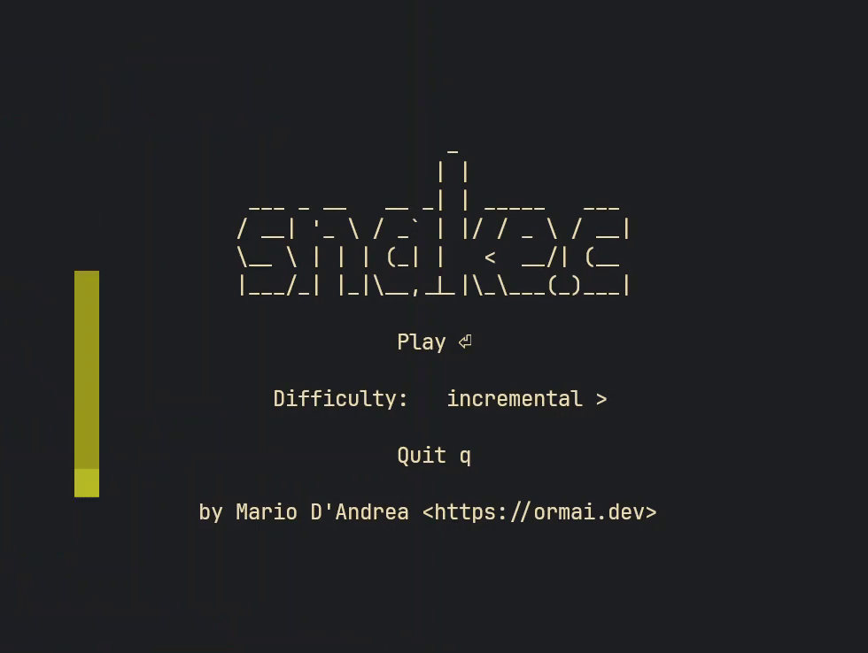

# Snake

The [snake](https://en.wikipedia.org/wiki/Snake_(1998_video_game)) game written in C for the terminal.

This is a small[^1] project that only depends on libc. It uses POSIX APIs and escape codes to interact with the terminal.



To build the game `git`, `make`, and a modern C compiler are required.

Build instructions:

```sh
git clone https://github.com/ormai/snake.git
cd snake/
make
./snake
```

You can move with <kbd>w</kbd> <kbd>a</kbd> <kbd>s</kbd> <kbd>d</kbd> or with <kbd>h</kbd> <kbd>j</kbd> <kbd>k</kbd> <kbd>l</kbd>, or just with the arrow keys. Press <kbd>q</kbd> to quit.

[^1]: 306 semicolons
